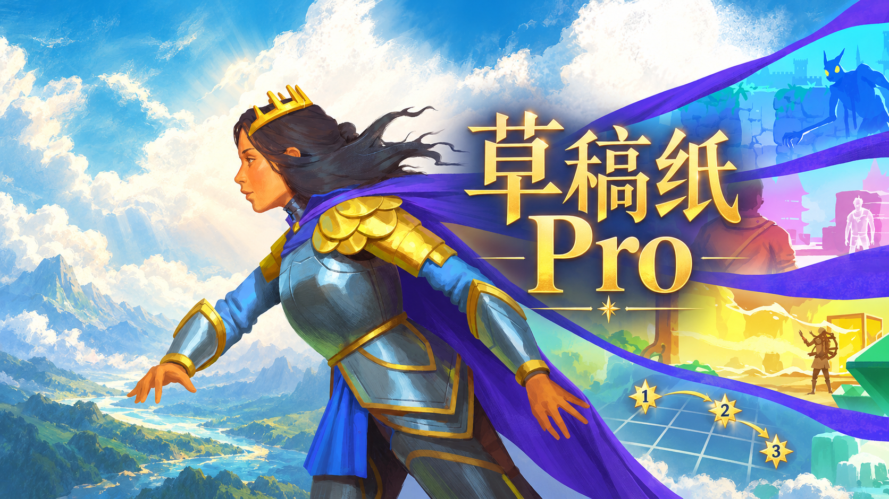

# StarSketch · 沉星之序游戏内草稿纸



An in-game sketchpad for **[Order of the Sinking Star](https://store.steampowered.com/app/499170/Order_of_the_Sinking_Star/)** on Windows x64 / DirectX 12.

在游戏画面上自由画线、画箭头、放置连续编号星标，并用半透明棋盘辅助观察。网格直接读取游戏数据和相机透视，保留手动校准。独立制作，非游戏官方组件。

**当前版本：0.1.3 测试版。** 新增图形安装器在线更新、错误编号和网格方向校验。原数据网格路径已在 r67271 / Steam Build 26006400 的 `torc_blocked` 小关卡、3840×2160 实机验证；0.1.3 的新校验以数值回归验证，用户报告的翻转现场尚未实机复现。其他关卡、多层角色、分辨率与图形模组组合尚未全面验证。

0.1.2 已验证每次打开自动定位，以及主世界普通斜俯视下 3840×2160 ↔ 3200×1800 的自动刷新；小关卡贴合精度与更多分辨率仍需覆盖。详见验证记录。

## 下载与安装

**两种安装方式同时提供，任选一种。** 两个 ZIP 内的游戏功能与 DLL 完全相同，均为 0.1.3 测试版，无需安装开发环境。完整下载列表见 [0.1.3 Release](https://github.com/ResidualNight/order-of-the-sinking-star-sketchpad/releases/tag/v0.1.3-test)。

| 方式 | 下载文件 | 适合的操作 |
| --- | --- | --- |
| 可视化安装 / 更新 / 卸载 | [StarSketch-0.1.3-installer.zip](https://github.com/ResidualNight/order-of-the-sinking-star-sketchpad/releases/download/v0.1.3-test/StarSketch-0.1.3-installer.zip) | 选择游戏文件夹，安装、检查插件更新或卸载 |
| 直接复制文件与文件夹 | [StarSketch-0.1.3-r67271-test.zip](https://github.com/ResidualNight/order-of-the-sinking-star-sketchpad/releases/download/v0.1.3-test/StarSketch-0.1.3-r67271-test.zip) | 自己将 DLL 和资源文件夹复制到游戏目录 |

### 方式一：可视化安装 / 卸载

1. 保存进度并退出游戏，完整解压 `StarSketch-0.1.3-installer.zip`。
2. 双击 `StarSketch-安装卸载.exe`，也可使用同目录的 `StarSketch-安装卸载.cmd`。
3. 浏览选择或粘贴游戏安装文件夹，里面应直接包含 `sinking_star.exe`，再点击“安装 / 更新”。
4. 照常从 Steam 启动游戏，按 **E** 打开草稿纸。

安装器打开时自动从本项目 GitHub Release 检查新版，也可点击“检查插件更新”。发现新版会询问是否更新；选择“是”后自动下载、校验并更新，选择“否”不改动安装。测试版更新也会被识别，版本相同或更旧时不覆盖。

游戏目录保留 `StarSketch-Manager/StarSketch-安装卸载.cmd`，删除原下载包后仍可检查更新或卸载。旧 0.1.2 管理器需要先下载本版安装器更新一次，之后即可在线更新。工具按安装记录和文件哈希处理自身文件，保留游戏、存档和无关文件；游戏运行时拒绝替换。已知手动安装的 0.1.1 / 0.1.2 也可更新或卸载。详见 [安装工具说明](docs/安装工具说明.md)。

### 方式二：直接复制文件与文件夹（继续保留）

1. 保存进度并退出游戏，解压 `StarSketch-0.1.3-r67271-test.zip`。
2. 将包内的 **`dxgi.dll` 和整个 `StarSketch-assets/` 文件夹**复制到 `sinking_star.exe` 同级目录；不要在中间多套一层解压文件夹。
3. 保留包内的使用说明和 `licenses/`，照常从 Steam 启动游戏，按 **E** 打开草稿纸。

复制后的位置应如下：

```text
游戏安装文件夹/
├─ sinking_star.exe
├─ dxgi.dll
└─ StarSketch-assets/
   └─ NotoSerifSC.ttf
```

手动更新时退出游戏，再替换本工具的 DLL 和资源。手动卸载时退出游戏，移除本工具的 `dxgi.dll` 及 `StarSketch-assets/` 内的原字体；有自行添加的文件时请保留，不必删除其他说明、许可证或游戏文件。此方式无需运行安装脚本。

两种方式均需先退出游戏再安装、更新或卸载。若游戏目录已有其他模组的 `dxgi.dll`，请先处理兼容性，不要直接覆盖；可视化工具遇到未知 DXGI、已修改的安装文件或路径链接会停止操作，不会关闭游戏。

## 操作

除 E 外，工具快捷键只在绘画模式下生效。

| 按键 | 功能 |
| --- | --- |
| E | 进入 / 退出绘画 |
| B | 自由画笔，左键拖动 |
| A | 箭头，左键拖动确定两端 |
| P | 编号星标，左键单击放置 |
| 按住右键 | 局部擦除笔迹，整枚删除箭头和星标 |
| G | 网格显示及箭头 / 星标格心吸附 |
| T | 全屏半透明棋盘染色 |
| Shift+G | 手动四点透视校准 |
| C | 清空标记，保留网格与染色，可撤销 |
| Ctrl+Z / Ctrl+Y | 撤销 / 重做 |
| Esc | 取消当前笔画 / 校准，或返回游戏 |

工具栏可调整颜色、粗细、大小和透明度，提供重新识别、快速三点校准及网格精调。没有使用 F1–F12。

已有标记始终固定在屏幕上，退出绘画后继续显示；退出游戏后不保存草稿。中文输入法仅在本游戏窗口内禁用，不修改系统布局或其他应用。

## 网格与适用范围

自动定位只对已核验的游戏可执行文件哈希启用。它读取当前逻辑网格、角色高度层和新的相机帧，保留完整透视除法，无需识别地砖纹理。每次按 E 打开草稿纸都会自动定位，不要求先启用网格或染色；游戏渲染尺寸或画布尺寸变化后，等待尺寸稳定 250ms 再自动定位。连续切换会取消前一次未完成的定位，使用最新尺寸。定位等待或失败时暂停旧网格的吸附与染色；一般绘画期间冻结网格。

多个角色分层时，默认选择投影位置最接近屏幕中心的角色层，可在“网格精调”覆盖高度或恢复角色层。数据失效会暂停旧自动结果的吸附；版本未验证时使用手动校准。主世界 Tab/Q 地图视角不在本版支持目标内。

## 从源码构建

Switch / OBS 独立投屏版目前处于开发设计阶段，计划优先移植草稿纸和手动网格校准，详见 [独立投屏版开发方案](docs/独立投屏版开发方案.md)。当前下载包仍为 PC 游戏内版本。

0.1.3 起报错带固定编号，例如 `[SS-GRID-006]` 表示等待新相机帧超时，`[SS-GRID-011]` 表示本次拒绝了方向异常的相机且未取得正常结果。反馈时提供完整编号、触发操作和关卡/分辨率；详见 [错误代码](docs/错误代码.md)。

需要 Windows x64、PowerShell 5.1+ 和网络连接（首次获取编译器）。依赖源码与字体已经包含在仓库，工具链不进入 Git 历史。

```powershell
.\setup.ps1
.\build.ps1
.\package.ps1
# 可选：从上一步的玩家 ZIP 生成图形安装包
.\package-installer.ps1
# 安装器回归：仅操作 work/ 内的隔离目录
powershell.exe -NoProfile -ExecutionPolicy Bypass -File .\tests\installer_tests.ps1
powershell.exe -NoProfile -ExecutionPolicy Bypass -File .\tests\update_tests.ps1
```

已有 LLVM-MinGW 20251021 工具链时：

```powershell
.\build.ps1 -ToolchainPath '你的 llvm-mingw 工具链目录'
```

`build.ps1` 编译 DLL、核心测试、界面生命周期测试和旧图像诊断工具，并运行两组测试。产物在 `build/`；`package.ps1` 生成仅包含玩家运行文件、说明和许可证的 ZIP 到 `dist/`。默认构建不会启动游戏或替换已安装的 DLL。

## 项目结构

| 目录 | 内容 |
| --- | --- |
| `src/` | DXGI/DX12、标记模型、界面、只读游戏数据定位 |
| `tests/` | 核心、界面生命周期与安装器回归，数字相机样本及诊断源码 |
| `installer/` | 图形窗口、安装/卸载模块及原生启动器源码 |
| `docs/` | [功能规格](docs/功能规格.md)、[网格实现](docs/网格数据方案评估.md)、[验证记录](docs/验证记录.md)、[更新记录](docs/更新记录.md) |
| `assets/` | Noto Serif SC 字体与许可证 |
| `third_party/` | 构建需要的 ImGui 源码与来源记录 |

本地认证、工具链、构建结果、游戏截图、游戏提取数据和研究日志均被排除。玩家二进制通过 Releases 分发，不放进源码历史。

## 许可证

项目代码采用 [MIT](LICENSE)。第三方组件遵循各自许可证，来源与适用范围见 [THIRD_PARTY_NOTICES.md](THIRD_PARTY_NOTICES.md)。仓库不包含游戏程序或关卡包。README 封面基于游戏官方宣传图编辑，相关游戏美术归原权利方所有，不适用本项目 MIT 许可证。
